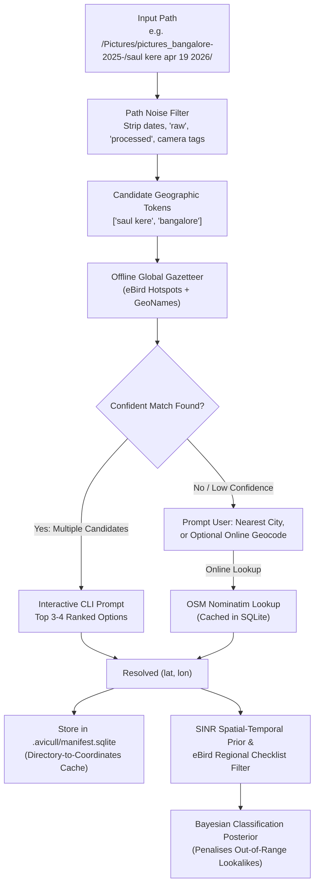

# Global Gazetteer & Directory Path Location Inference Design

**Date**: 2026-10-25  
**Status**: Draft (Under Review)  
**Target Component**: `avicull` (Location Inference & Prior Engine)

---

## 1. Intent & The Why

When organizing large wildlife photo archives taken with DSLRs or mirrorless cameras (such as Canon EOS bodies), image files frequently lack embedded GPS coordinates in their EXIF metadata. Without spatial coordinates, `avicull` cannot apply its SINR spatio-temporal prior or eBird regional checklist filters. As a result, the visual classifier (BioCLIP) relies purely on visual similarity, occasionally causing geographic hallucinations—such as misidentifying an Indian Brahminy Kite as a North American Bald Eagle, or mistaking local cormorants for Black Swans or African equivalents.

However, photographers almost always structure their archives with contextual directory names (e.g., `pictures_bangalore-2025-/saul kere apr 19 2026`, `Pictures/Leh`, `ranthambore oct 2025`). By parsing these directory paths, filtering out noise, matching against an authoritative global gazetteer, and presenting an interactive 3–4 choice disambiguation prompt, `avicull` can deterministically establish the geographic origin `(latitude, longitude)` and feed it directly into the spatial prior and regional species checklist.

---

## 2. Goals, Non-Goals, and Anti-Goals

### Goals
1. **Intelligent Path Token Extraction**: Automatically traverse the directory hierarchy for photo bundles, ignoring structural noise (`raw`, `processed`, `export`, dates like `2025-04-19` or `oct 2025`), and extract candidate geographic terms.
2. **Global Offline Gazetteer**: Provide an embedded, zero-network global location registry covering worldwide birding hotspots (eBird Hotspots registry, WDPA national parks and reserves) and populated places/cities (GeoNames), stored in a compact binary format (`~3–5 MB`).
3. **Interactive Disambiguation**: In interactive terminal sessions when GPS EXIF is missing, present 3–4 ranked location matches for quick selection, plus an option to manually enter a city/name or skip.
4. **Optional Online Geocoding Fallback**: For ultra-local spots (e.g., small neighborhood lakes or local parks) not in the offline registry, offer an optional one-time online lookup (via OpenStreetMap Nominatim), caching the resulting coordinates.
5. **Repeatable Update Pipeline**: A Python script (`scripts/build_gazetteer.py`) and GitHub Action workflow to periodically fetch upstream dataset updates, rebuild the gazetteer artifact, run schema/data assertions, and commit updates.
6. **Prior & Checklist Integration**: Propagate resolved `(lat, lon)` into the SINR prior and eBird regional checklists so out-of-region lookalikes are penalised in posterior probability calculations.
7. **Persistent Decisions**: Cache confirmed location decisions in `.avicull/manifest.sqlite` so users are never re-prompted for previously confirmed directories.

### Non-Goals
- Real-time continuous GPS tracking or reverse geocoding of every individual image file when GPS is already present in EXIF.
- Replacing the primary computer vision stack (BioCLIP / YOLO11); this design enhances the Bayesian prior and filtering stage.
- Full text search over arbitrary addresses or street-level house numbers.

### Anti-Goals
- Requiring an active internet connection for standard operation. The system must remain 100% functional offline using the embedded gazetteer.
- Blocking or stalling batch/headless runs in non-interactive environments (CI, cron, headless scripts). Headless execution must gracefully use defaults, `--location`, or proceed without prior if not specified.
- Mutating any files or metadata in the source archive (`--input`).

---

## 3. Constraints

1. **Strict Source Immutability**: The source archive is strictly read-only.
2. **Zero-Byte Output Tree**: Hard links on APFS must continue to consume 0 additional bytes.
3. **Offline-First & Fast Startup**: The gazetteer lookup must be instantaneous (< 5ms per query), with in-memory or memory-mapped lookups.
4. **Memory Footprint**: The gazetteer data structure must not consume more than 25 MB of RAM in the Rust process.
5. **No Breaking Changes**: Existing commands (`organize`, `report`, `relink`) and flags must remain backward-compatible.

---

## 4. Architecture & Key Mechanisms



### 4.1 Path Parsing & Token Extraction
The parser decomposes the directory path leading to each photo bundle into path components.
1. **Noise Removal**:
   - Matches known structural folders: `raw`, `processed`, `export`, `jpg`, `jpeg`, `final`, `selects`, `dcim`, `100canon`, etc.
   - Matches temporal tokens via regex: `YYYY-MM-DD`, `YYYYMMDD`, month names (`jan`, `feb`, `october 2025`, `apr 19 2026`).
2. **Candidate Extraction**:
   - Isolates meaningful folder names from the leaf folder up to the input root.
   - Example: For `/Pictures/pictures_bangalore-2025-/saul kere apr 19 2026/1X7A5242.CR2`, the candidates extracted are `["saul kere", "pictures_bangalore", "bangalore"]`.
   - Cleans delimiters (underscores, dashes) into search phrases: `"saul kere"`, `"bangalore"`.

### 4.2 Global Gazetteer Artifact & In-Memory Matching
- **Source Datasets**:
  1. **eBird Global Hotspots**: ~100,000 global birding hotspots (names, country code, subnational code, lat, lon).
  2. **GeoNames Cities & Administrative Areas**: Cities with population > 15,000 and major administrative regions (states/provinces/districts).
  3. **World Database on Protected Areas (WDPA)**: National parks, wildlife sanctuaries, tiger reserves, nature reserves.
- **Storage Format**:
  - Pre-processed by `scripts/build_gazetteer.py` into a compact binary table (or SQLite / compressed JSON/bincode) `data/gazetteer.bin`.
  - Stored with normalized names, trigram index or prefix trie, coordinates, country/region, and importance weight (hotspot > city > administrative).
- **Matching Algorithm**:
  - Trigram similarity + exact substring matching.
  - Scores candidates by string similarity and location prominence.

### 4.3 User Interaction & Disambiguation
- When running in an interactive TTY and GPS EXIF is absent:
  - If confident matches exist, displays:
    ```text
    Detected location candidates for 'pictures_bangalore-2025- / saul kere apr 19 2026':
      [1] Saul Kere (Lake), Bangalore, Karnataka, India (12.919°N, 77.677°E) [Hotspot]
      [2] Bengaluru / Bangalore, Karnataka, India (12.972°N, 77.594°E) [City]
      [3] Bangalore Rural, Karnataka, India (13.220°N, 77.560°E) [District]
      [4] Enter custom location or search online
      [s] Skip location prior for this folder
    Select [1-4, s] (default: 1):
    ```
- Non-Interactive / Batch Mode:
  - If `--location <NAME_OR_COORDS>` is passed, uses that directly.
  - If running without TTY (e.g. piped or daemon) and no `--location` provided, automatically selects the highest-scoring candidate if confidence exceeds 0.85, else logs a warning and proceeds without spatial prior.

### 4.4 Optional Online Geocoding Fallback
- If the user selects option 4 or an unknown query:
  - Prompts: `Search online for location? [y/N]: `
  - Makes a single rate-limited HTTP request to OpenStreetMap Nominatim with a descriptive user agent.
  - Caches the response permanently in `.avicull/manifest.sqlite` under table `location_cache(query TEXT PRIMARY KEY, lat REAL, lon REAL, display_name TEXT)`.

### 4.5 Repeatable Update Pipeline
- `scripts/build_gazetteer.py`:
  - Downloads fresh public snapshots of eBird Hotspots and GeoNames.
  - Normalizes, deduplicates, and encodes the binary gazetteer artifact into `data/gazetteer.bin`.
- GitHub Action (`.github/workflows/update_gazetteer.yml`):
  - Scheduled to run periodically (monthly or on dispatch).
  - Rebuilds `data/gazetteer.bin`, runs verification assertions (e.g., verifying that "Saul Kere", "Ranthambore", "Leh", "Central Park", "Kruger" resolve accurately), and commits/creates a PR if data changed.
- Pre-push hook:
  - Fast schema integrity check ensuring `data/gazetteer.bin` is readable and valid.

### 4.6 Clustering, Precedence, and Prioritization Decisions (Builder Review Calls)
- **EXIF Precedence**: True hardware camera EXIF GPS and sibling EXIF propagation take precedence over path-based gazetteer inference. The gazetteer and interactive prompt are triggered *only* when a trip cluster has zero EXIF GPS data across all its bundles.
- **Prompt Clustering Granularity**: Bundles are clustered by their most specific non-noise directory path component (e.g. `pictures_bangalore-2025- / saul kere apr 19 2026` vs `pictures_bangalore-2025- / ranthambore oct 2025`). Leaf noise folders (`raw`, `processed`, `selects`, `100canon`) inherit the resolved coordinates of their parent trip folder. A user is prompted at most once per distinct trip directory.
- **Cache Schema**: `.avicull/manifest.sqlite` stores confirmed coordinates keyed by `trip_relative_path`:
  ```sql
  CREATE TABLE IF NOT EXISTS directory_locations (
      path_key TEXT PRIMARY KEY,
      resolved_name TEXT NOT NULL,
      latitude REAL NOT NULL,
      longitude REAL NOT NULL,
      source TEXT NOT NULL,
      updated_at INTEGER NOT NULL
  );
  ```
- **CLI Flag Semantics**:
  - `--location <NAME_OR_COORDS>` acts as a global override for all bundles that lack EXIF GPS, bypassing interactive prompts.
  - `--no-prompt` runs in non-interactive mode: accepts top candidate if confidence > 0.85, otherwise proceeds unlocated.

### 4.7 Simple eBird Regional Checklist Matrix Prior
- **Regional Encoding**:
  - Every entry in the gazetteer includes ISO country (e.g. `IN`, `US`, `KE`, `AU`) and subnational administrative region (e.g. `IN-KA` for Karnataka, `IN-RJ` for Rajasthan, `IN-LA` for Ladakh).
  - A lightweight binary/JSON lookup table (`data/regional_checklists.bin`) maps regional codes (`country` or `state/subnational`) to bitsets or sets of valid eBird taxon IDs.
- **Bayesian Posterior Weighting**:
  - For a photo bundle with resolved location `(lat, lon, region_code)`:
    - **Native / Recorded Species**: Species present in the region's eBird checklist receive a neutral-to-supportive prior multiplier ($1.0$).
    - **Geographically Implausible Species**: Species outside the regional checklist (e.g., Bald Eagle `Haliaeetus leucocephalus`, Black Swan `Cygnus atratus`, or African endemic raptors in `IN-KA`) receive an aggressive penalty multiplier ($0.001$).
  - When location is unassigned or skipped, all species receive equal prior ($1.0$), preserving unconstrained visual classification.
- **Simplicity**: No heavy neural ONNX spatial networks; fast $O(1)$ set/bitset membership check executed in milliseconds.

---

## 5. What's Left to the Builder

- Exact binary serialization format for `data/gazetteer.bin` and `data/regional_checklists.bin` (e.g. `bincode` or compact binary).
- Threshold tuning for trigram fuzzy matching score cutoffs.
- Specific terminal styling (ANSI color formatting / `dialoguer` crate integration).
- Caching mechanism for OSM Nominatim requests in SQLite.

