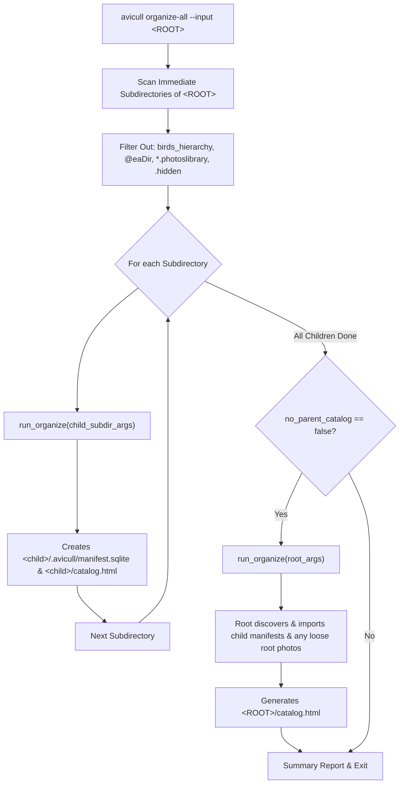

# Design Document: `avicull organize-all` Subcommand

- **Author**: Antigravity & User
- **Date**: 2026-11-11
- **Status**: Ready for Plan (Builder Check Resolved)
- **Target**: `src/cli.rs`, `src/organizer/mod.rs`, `src/organizer/batch.rs`, `src/main.rs`

---

## 1. Intent & Context

Photographers frequently store large multi-trip or multi-year archives structured into subdirectories (e.g., `Pictures/2025/Ladakh/`, `Pictures/2025/Coorg/`, `Pictures/2025/K Gudi/`). 

Running `avicull organize` directly against the massive root archive has two distinct drawbacks:
1. **Monolithic Task**: If interrupted or stalled on a large library, progress tracking is coarse.
2. **Missing Per-Trip Catalogs**: Users want a standalone, offline `catalog.html` and `.avicull/manifest.sqlite` inside each trip folder for modular browsing and sharing, while still wanting an aggregated parent `catalog.html` at the root.

`avicull` already has built-in child manifest inheritance (`discover_child_manifests` and `import_child_manifest`), allowing a parent manifest to import child databases in milliseconds without re-running neural network inference.

`avicull organize-all` orchestrates this end-to-end: it processes each child subdirectory sequentially, initializes individual SQLite databases and catalogs, and finishes by rolling them up into the parent catalog.

---

## 2. Goals, Non-Goals & Anti-Goals

### Goals
- **Sequential Subdirectory Execution**: Discover and process immediate child subdirectories one by one.
- **Idempotency & Fast Resume**: Subdirectories that already have an initialized SQLite manifest and `catalog.html` utilize `avicull`'s existing sub-second delta check: if no new photos were added, they complete in milliseconds without ML execution. If photos were added, only the new bundles are classified.
- **Child Manifest Aggregation**: Automatically perform a roll-up on the parent directory once children finish, producing the root `catalog.html` with zero redundant ML inference.
- **Robust Error Handling & Signal Resilience**: If one child folder encounters an error, log it and proceed with the remaining folders, reporting a final summary. Stop cleanly on `SIGINT` (`Ctrl+C`).
- **In-Process Architecture**: Extract `organize` execution into a shared callable function (`run_organize`) rather than launching external OS sub-processes, ensuring consistent signal handling and fast in-memory execution.
- **Full Invariant Preservation**: Strictly preserve default source immutability (`--mode in-place`), skip directories (`birds_hierarchy`, `@eaDir`, `*.photoslibrary`, hidden dirs), and avoid dataless cloud hydration bugs.

### Non-Goals
- Arbitrary deep recursion of nested sub-subdirectories (only immediate child subdirectories are dispatched; deeper subfolders are naturally handled by `avicull`'s existing recursive scanner within each child).
- Parallel multi-process subdirectory execution (concurrency is already maximized per-directory via Rayon threads and GPU batching).

### Anti-Goals
- Deleting or re-initializing existing child SQLite databases or catalogs on re-runs unless `--force` is explicitly provided.
- Blocking the entire run if an individual folder has permission issues or unreadable files.

---

## 3. CLI Interface & Parameters

```rust
#[derive(Args, Debug, Clone)]
pub struct OrganizeAllArgs {
    /// Read-only root directory containing trip subdirectories (defaults to current directory)
    #[arg(short, long, default_value = ".")]
    pub input: PathBuf,

    /// Target root directory in hierarchy mode (defaults to <INPUT>/birds_hierarchy)
    #[arg(short, long)]
    pub output: Option<PathBuf>,

    /// Skip generating the aggregated root catalog after all subdirectories finish
    #[arg(long, default_value_t = false)]
    pub no_parent_catalog: bool,

    /// Organization mode: [in-place | in-place-rename | hierarchy] (default: in-place)
    #[arg(long, value_enum, default_value_t = OrganizationMode::InPlace)]
    pub mode: OrganizationMode,

    /// Run non-interactively without prompting
    #[arg(long, default_value_t = false)]
    pub no_prompt: bool,

    /// Force re-running detection and classification even if subdirectories are already organized
    #[arg(long, default_value_t = false)]
    pub force: bool,

    /// Enable verbose progress reporting
    #[arg(short, long, default_value_t = false)]
    pub verbose: bool,

    /// Rayon worker thread count for I/O and preprocessing
    #[arg(long)]
    pub threads: Option<usize>,

    /// Directory containing exported .onnx and .safetensors files
    #[arg(long)]
    pub models_dir: Option<PathBuf>,

    /// Fallback default latitude
    #[arg(long)]
    pub default_lat: Option<f64>,

    /// Fallback default longitude
    #[arg(long)]
    pub default_lon: Option<f64>,

    /// Optional TOML file mapping trip folder keywords to {lat, lon}
    #[arg(long)]
    pub locations_file: Option<PathBuf>,

    /// Threshold for Confirmed vs _Needs_Review (default: 0.65)
    #[arg(long, default_value_t = 0.65)]
    pub min_confidence: f32,

    /// YOLO11 bird detection confidence floor (default: 0.25)
    #[arg(long, default_value_t = 0.25)]
    pub min_detect: f32,
}
```

---

## 4. Architecture & Workflow



### 4.1 Subdirectory Discovery & Filtering
1. Read entries directly inside `--input`.
2. Skip any entry that is not a directory.
3. Skip any directory matching:
   - Hidden directories (starting with `.`, including `.avicull`, `.git`).
   - `birds_hierarchy`.
   - Apple Photos libraries (`*.photoslibrary`).
   - Synology NAS metadata (`@eaDir`).
4. Sort matching subdirectories alphabetically for deterministic execution.

### 4.2 Sequential In-Process Organization
For each matching subdirectory `child_dir`:
1. Synthesize `OrganizeArgs` for `child_dir`:
   - `input`: `child_dir`
   - `output`: in hierarchy mode, `<child_dir>/birds_hierarchy` (or `<output>/<child_name>` if an explicit output directory was given)
   - Forward all relevant user settings (`mode`, `no_prompt`, `force`, `verbose`, `threads`, `models_dir`, etc.).
2. Invoke `run_organize(child_args)`.
3. If `child_dir` is already organized and no new photos were added, `run_organize`'s built-in fast-path returns in ~5ms. If new files were added, it processes only the deltas.

### 4.3 Aggregated Root Rollup
When all child directories have completed, unless `--no-parent-catalog` is set:
1. Synthesize `OrganizeArgs` for `<ROOT>`:
   - In `InPlace` mode, `<ROOT>/.avicull/manifest.sqlite` is opened.
   - `discover_child_manifests(&ROOT)` finds all newly created child `.avicull/manifest.sqlite` files.
   - `import_child_manifest` loads all bundle metadata with child-relative paths into the root database.
   - Any loose photo bundles residing directly in `<ROOT>` are also scanned and processed.
   - `generate_html_catalog` creates `<ROOT>/catalog.html`.
2. Result: The outermost `catalog.html` displays all photos across all subdirectories with functional links, while each child directory retains its own independent catalog.

---

## 5. Verification & Testing Strategy (TDD)

Per `AGENTS.md`, strict TDD is followed:
1. **Unit / Spec Integration Tests** in `tests/test_suite/test_organize_all.rs`:
   - Verification of child directory discovery and exclusion of `birds_hierarchy`, `@eaDir`, `.photoslibrary`, and hidden folders.
   - Verification of incremental sub-second delta skip when subdirectories are already organized.
   - Verification of sequential organization of multiple child directories, creating distinct databases and catalogs.
   - Verification of automatic parent rollup creating root `catalog.html` containing bundles from all child subdirectories.
2. **Quality Gates**:
   - `cargo fmt --check`
   - `cargo clippy --all-targets --all-features -- -D warnings`
   - `cargo test --test test_suite`
   - `RUSTDOCFLAGS="-D warnings" cargo doc --no-deps`
